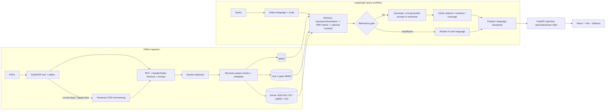

# Architecture

## Layout
| Path | Purpose |
|---|---|
| `backend/app/ingestion` | PDF extraction, OCR, legacy-font detection, cleaning, sections, chunking |
| `backend/app/retrieval` | tokenizers, BM25, n-gram, dense, RRF, reranker, translation, expansion |
| `backend/app/generation` | LangGraph, relevance gate, LLM client, extractive composer, citation verifier |
| `backend/app/evaluation` | metrics, golden set, retrieval matrix, ablations, generation eval |
| `backend/scripts` | data build, ingestion, golden set, review import, evaluation |
| `frontend/src` | chat, scheme explorer, SSE client |

## Design decisions & trade-offs
* **Lexical first, neural optional.** BM25 + char n-grams run anywhere; BGE-M3/E5/LaBSE and the reranker load lazily and the system falls back (and says so in `/api/health`) when they are unavailable.
* **Structure chunking** (one chunk per Eligibility/Benefits/Documents/How-to-apply section, tables kept intact) vs fixed-size is an ablation, not an assumption.
* **Abstention over guessing**: a coverage/reranker gate, `NOT_FOUND` handling in the LLM prompt, and a deterministic citation verifier that drops unsupported sentences.
* **Streaming** delivers the answer after verification (so unverified text is never shown); stages stream live.
* **Honest evaluation**: thresholds tuned on a dev split only; ORACLE and NOT RUN rows are labelled.
